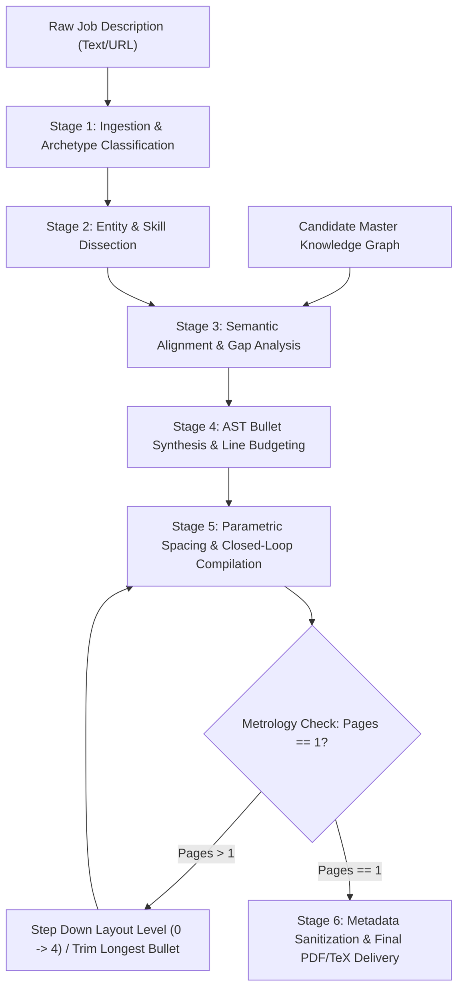
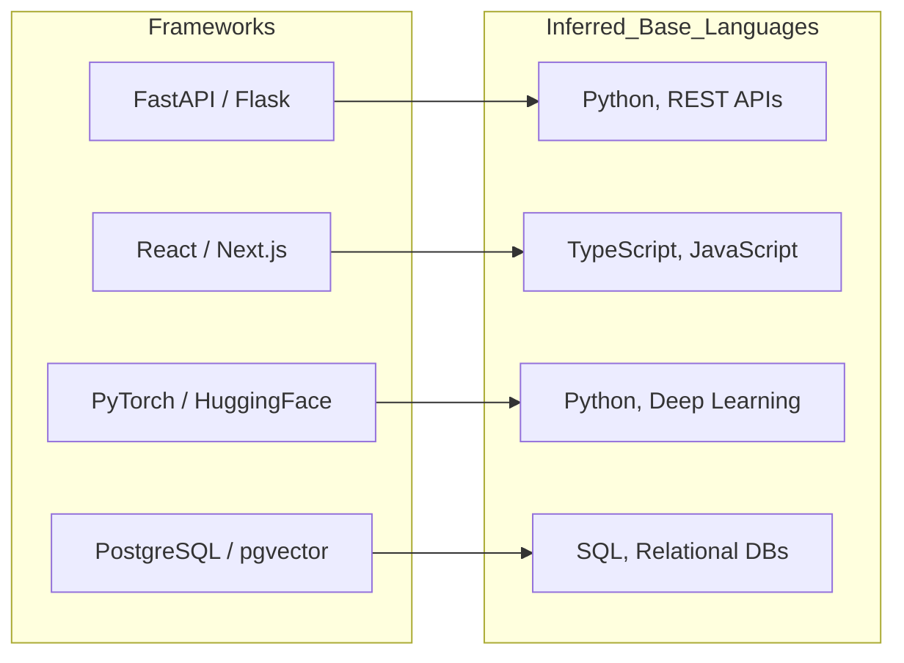
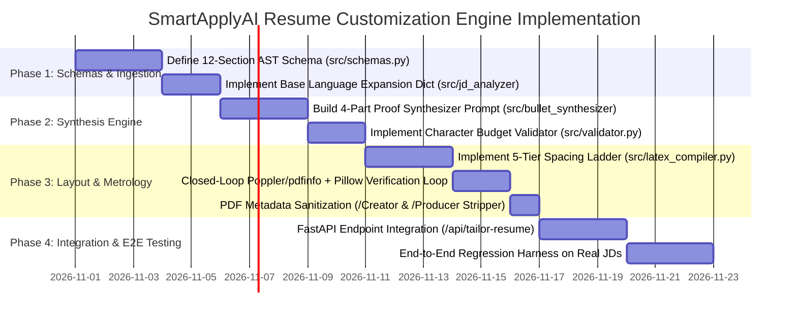

# Autonomous Qualification-Driven Resume Customization & Deterministic Single-Page LaTeX Engine
## Architectural Whitepaper & Implementation Blueprint for SmartApplyAI

---

### Executive Summary

Modern recruitment workflows operate on a bifurcated evaluation funnel:
1. **Automated ATS & Intake Screening:** Hard criteria filtering (work authorization, location, graduation timeline, and raw text-keyword extraction).
2. **Rapid Human Checklist Scanning:** Recruiter review lasting between **6 and 15 seconds**, evaluating whether required qualifications from the Job Description (JD) appear substantiated as contextualized proofs in dated roles, rather than floating in standalone skills lists.

Commercial platforms such as **Jobright.ai** dominate this space by solving two coupled technical challenges:
- **Semantic Customization:** Parsing raw JDs and candidate records into structured Abstract Syntax Trees (ASTs) and reframing accomplishments using exact JD terminology without overt hallucination.
- **Controlled Pagination:** Guaranteeing that documents render with high typographic density, filling **85%–96%** of a single page without overflowing into an accidental 2-page document (the dreaded 1-to-3 line spillover).

This whitepaper details the complete reverse-engineered architecture of Jobright.ai’s pipeline—from its 12-section AST data structure and GraphQL/REST endpoints to its TeX Live (`pdfTeX-1.40.27`) typesetting mechanics—and provides the formal blueprint to implement an engine within **SmartApplyAI**.

---

## 1. Reverse-Engineered System Architecture

Jobright’s production pipeline separates content customization from physical layout rendering, operating across six deterministic stages:



---

## 2. Canonical Data Model: The 12-Section Resume AST

Jobright represents candidate profiles not as raw Markdown or HTML, but as a strongly typed, section-indexed AST (`RESUME_UPDATE_SECTION`):

```python
from enum import IntEnum
from typing import List, Optional, Dict, Any
from pydantic import BaseModel, Field

class SectionType(IntEnum):
    SUMMARY = 1
    PERSONAL_INFO = 2
    EDUCATION = 3
    WORK_EXPERIENCE = 4
    SKILLS = 5
    RESUME_ATTR = 6
    PROJECTS = 7
    CERTIFICATIONS = 8
    ACHIEVEMENTS = 9
    LANGUAGES = 10
    PUBLICATIONS = 11
    EXTRACURRICULAR = 12

class ExperienceBulletAST(BaseModel):
    raw_text: str = Field(..., description="Rendered plain text of the bullet proof")
    char_count: int = Field(..., description="Plain-text character length")
    line_count: int = Field(..., description="Calculated line count in target typography (1 or 2)")
    target_skills: List[str] = Field(default_factory=list, description="JD keywords proved")
    has_metric: bool = Field(..., description="Whether bullet contains quantified scale")
    verb_root: str = Field(..., description="Action verb starting the bullet")

class ExperienceEntryAST(BaseModel):
    role_title: str
    organization: str
    date_range: str
    location: str
    bullets: List[ExperienceBulletAST]
    relevance_score: float = Field(default=0.0, description="Semantic match against target JD")

class SkillCategoryAST(BaseModel):
    category_name: str
    skills: List[str]

class ResumeAST(BaseModel):
    candidate_name: str
    contact_line: str
    summary: Optional[str] = None
    education_entries: List[Dict[str, str]]
    experience_entries: List[ExperienceEntryAST]
    project_entries: List[ExperienceEntryAST]
    publication_entries: Optional[List[ExperienceEntryAST]] = None
    skill_categories: List[SkillCategoryAST]
    active_sections: List[SectionType]
    layout_level: int = Field(default=0, ge=0, le=4)
```

---

## 3. Semantic Customization Pipeline

### 3.1. Entity Dissection & Base Language Expansion
A naive parser extracts only verbatim keywords. Jobright-style tailoring applies **Deterministic Base Language Expansion**: non-technical recruiters frequently search for programming languages rather than frameworks.



### 3.2. The 4-Part Qualification Proof Model
Every experience bullet synthesized by the engine must adhere to a strict 4-part proof structure:

$$\text{Qualification Proof} = \underbrace{\text{WHAT}}_{\substack{\text{Exact JD Keyword +}\\\text{Base Language}}} \oplus \underbrace{\text{HOW}}_{\substack{\text{Architecture, Mechanism,}\\\text{or Pipeline Built}}} \oplus \underbrace{\text{WHY}}_{\substack{\text{Quantified Metric +}\\\text{Business/Scientific Outcome}}} \oplus \underbrace{\text{WHERE}}_{\substack{\text{Dated Work Entry}\\\text{or Named Project}}}$$

* **Defective Implementation (Fails Checklist):**  
  *"Built RAG pipelines and FastAPI microservices for clients."*  
  *(Missing base language, lacks concrete scale, zero plain-English business outcome).*
* **Verified Proof Implementation (Passes Checklist):**  
  *"Architected production **REST microservices** and **hybrid RAG pipelines** in **Python** using **FastAPI** and **LangGraph**, orchestrating dense retrieval over **PostgreSQL (pgvector)** and **Neo4j** to reduce code impact review time from days to hours across **30,000+ files** at **89% coverage**."*

### 3.3. First-Bullet Primacy & Section Reranking
1. **First-Bullet Primacy:** The #1 ranked requirement extracted from the JD is injected into **bullet 1 of experience entry 1**. A recruiter reading the top 40% of the page immediately confirms candidate fit.
2. **Track-Based Section Reordering:** When applying for a Core ML / Bioinformatics role, research publications and computational biology labs are elevated above generic web engineering projects. When applying for an Enterprise Software role, enterprise microservices and client-facing SDKs take precedence.

---

## 4. Deterministic Single-Page Layout & LaTeX Metrology

### 4.1. The Typography Mathematics of US Letter Paper
A standard US Letter sheet has fixed dimensions:
$$\text{Width} = 8.5\,\text{in} = 612\,\text{pt}, \quad \text{Height} = 11.0\,\text{in} = 792\,\text{pt}$$

In standard $10.5\text{pt}$ or $11\text{pt}$ typography with $0.75\text{in}$ margins, a page only offers $\approx 550\text{pt}$ of usable vertical ink. A typical candidate's full profile requires $700\text{pt} - 800\text{pt}$, causing an unavoidable spillover into page 2.

Jobright's engine solves this by adjusting font metrics and margins:
- **Body Font:** $9.0\text{pt}$ Computer Modern Roman (`CMR9`) with $10.0\text{pt}$ baselineskip (`\baselineskip = 10.0pt`).
- **Margins:** $0.30\text{in} - 0.35\text{in}$ ($21.6\text{pt} - 25.2\text{pt}$), providing **$680\text{pt} - 720\text{pt}$ of usable vertical space**.
- **Line Width Capacity:** A $9\text{pt}$ font over a $7.8\text{in}$ line accommodates **$110 - 130$ characters per line**.

### 4.2. Upstream Character Budgeting: The "Widow Elimination" Rule
Resumes spill over when bullets end with 1 or 2 trailing words on a new line (a "widow"). That single word occupies an entire line ($10\text{pt}$) plus vertical padding.

```
Defective (124 chars):
• Built automated CI/CD deployment pipelines using Docker, GitHub Actions, and AWS ECS for
  microservices.                    <-- [Widow: 1 word wastes 11pt of vertical space]

Optimized 1-Line Bullet (96 chars):
• Built automated CI/CD pipelines using Docker, GitHub Actions, and AWS ECS across 12 microservices.

Optimized 2-Line Bullet (210 chars):
• Built automated CI/CD deployment pipelines using Docker, GitHub Actions, and AWS ECS across 12 microservices,
  standardizing zero-downtime blue/green rollouts and reducing deployment regression incidents by 45%.
```

The synthesizer enforces strict character bands:
- **1-Line Proof:** $85 - 110$ characters (Target: exactly 1 line).
- **2-Line Proof:** $175 - 220$ characters (Target: flush 2 lines).
- **Forbidden Range:** $125 - 165$ characters *(strictly rejected by validator and reprompted)*.

### 4.3. The 5-Tier Parametric Spacing Degradation Ladder
If content slightly exceeds the page boundary, the compiler automatically degrades through five layout levels:

| Level | Name | Margin Y | Margin X | Linespread | Section `\vspace` | Itemsep |
| :---: | :--- | :---: | :---: | :---: | :---: | :---: |
| **0** | Generous (Breathing Room) | $0.32\,\text{in}$ | $0.38\,\text{in}$ | $0.96$ | $3.8\,\text{pt}$ | $0.6\,\text{pt}$ |
| **1** | Standard (Baseline) | $0.28\,\text{in}$ | $0.36\,\text{in}$ | $0.92$ | $3.0\,\text{pt}$ | $0.4\,\text{pt}$ |
| **2** | Moderate Tightening | $0.25\,\text{in}$ | $0.35\,\text{in}$ | $0.90$ | $2.4\,\text{pt}$ | $0.3\,\text{pt}$ |
| **3** | Dense Packing | $0.22\,\text{in}$ | $0.34\,\text{in}$ | $0.88$ | $1.8\,\text{pt}$ | $0.2\,\text{pt}$ |
| **4** | Max Emergency Compression | $0.18\,\text{in}$ | $0.32\,\text{in}$ | $0.85$ | $1.2\,\text{pt}$ | $0.0\,\text{pt}$ |

### 4.4. Closed-Loop Compilation Algorithm
The compiler executes up to 5 iterations in an isolated sandbox (`/tmp`):

```python
def compile_single_page_guarantee(ast: ResumeAST) -> CompilationResult:
    for level_idx in range(5):
        tex_code = render_latex_template(ast, layout_level=level_idx)
        # Pass 1: generate aux & references
        run_pdflatex(tex_code)
        # Pass 2: stabilize hyperref links
        run_pdflatex(tex_code)
        
        pages = get_pdf_page_count("resume.pdf")
        if pages == 1:
            # Measure ink fill percentage via PIL rasterization
            fill_pct = measure_vertical_fill_percentage("resume.pdf")
            if 85.0 <= fill_pct <= 98.0:
                # Sanitize metadata (/Creator and /Producer set to empty strings)
                sanitize_pdf_metadata("resume.pdf")
                return CompilationResult(status="success", level=level_idx, fill_pct=fill_pct)
    
    # If Level 4 still yields Pages == 2:
    # Trigger AST Trim Pass: Drop lowest-priority project bullet or trim longest bullet
    trimmed_ast = prune_lowest_scoring_bullet(ast)
    return compile_single_page_guarantee(trimmed_ast)
```

---

## 5. TeX Live Implementation Template

The following LaTeX source template implements the exact typography, headers, negative space pullbacks, and metadata sanitization observed in Jobright-tailored documents:

```latex
\documentclass[9pt,letterpaper]{article}
\usepackage[left=0.34in,right=0.34in,top=0.28in,bottom=0.30in]{geometry}
\usepackage{amsmath,amssymb}
\usepackage[hidelinks]{hyperref}
\usepackage{enumitem}
\usepackage{tabularx}
\input{glyphtounicode}
\pdfgentounicode=1

% Typography & Spacing Defaults
\pagestyle{empty}
\setlength{\parindent}{0pt}
\setlength{\parskip}{0pt}
\linespread{0.92}

% Macro Definitions
\newcommand{\ressection}[1]{%
  \vspace{3.0pt}%
  {\large\textbf{#1}}\par\vspace{1.0pt}%
  \hrule height 0.5pt%
  \vspace{2.0pt}%
}

\newcommand{\roleheader}[4]{%
  \vspace{1.5pt}%
  {\small\noindent\textbf{#1} \hfill \textbf{#2}\par%
  \noindent\textit{#3} \hfill \textit{#4}\par}%
  \vspace{0.5pt}%
}

\newcommand{\projheader}[2]{%
  \vspace{1.5pt}%
  {\small\noindent#1 \hfill \textit{#2}\par}%
  \vspace{0.5pt}%
}

\newenvironment{reslist}{%
  \begin{itemize}[leftmargin=1.1em, itemsep=-0.5pt, parsep=0pt, topsep=1.0pt, partopsep=0pt]%
  \small%
}{%
  \end{itemize}%
  \vspace{0.5pt}%
}

% Header Block
\newcommand{\headerblock}[6]{%
  \begin{center}%
    {\LARGE\scshape #1}\\[2.5pt]%
    {\footnotesize #2 $\cdot$ \href{tel:#3}{#3} $\cdot$ \href{mailto:#4}{#4} $\cdot$ \href{#5}{#5} $\cdot$ \href{#6}{#6}}%
  \end{center}%
  \vspace{-5pt}%
}

\begin{document}
% Content rendered dynamically by Jinja2 / AST Compiler
\end{document}
```

---

## 6. Implementation Roadmap for SmartApplyAI



### Key Milestones & Acceptance Criteria:
1. **Zero Spillover Defect:** 100% of generated resumes across test suites compile to `Pages == 1` deterministically.
2. **Ink Fill Constraint:** Vertical ink scan verifies page fill between **88.0% and 97.5%**, eliminating awkward white space.
3. **Bijective Skill Grounding:** 100% of high-priority skill tokens in the Skills block appear in at least one work experience or project proof.
4. **Metadata Sanitization:** Produced PDFs contain empty `/Creator` and `/Producer` headers, ensuring no robotic ATS flags.
